# CarePredict - Full Results Report

*Generated 2026-10-27T11:22:05+00:00 UTC - model `random_forest` - public de-identified UCI Heart Disease (Cleveland) data.*

## 1. Executive summary

- **Task:** supervised binary classification of angiographic heart-disease presence from 13 clinical features on 303 records (45.9% positive).
- **Selected model:** `random_forest` (best tree-based model by cross-validated ROC-AUC).
- **Cross-validated ROC-AUC:** 0.897 +/- 0.030 (stratified 5-fold, training split).
- **Hold-out test ROC-AUC:** 0.949 (95% bootstrap CI 0.886-0.991, n=61).
- **Out-of-fold ROC-AUC on all 303 records:** 0.916 (95% CI 0.884-0.945); average precision 0.91; Brier score 0.12.
- **Versus baselines:** a majority-class dummy scores 0.500 AUC; logistic regression scores 0.902. The selected model differs from logistic regression by -0.005 AUC, which is within one fold-to-fold standard deviation.
- **Most influential features (mean |SHAP|):** Thalassemia test result, Major vessels coloured by fluoroscopy (0-3), Chest pain type.
- **Operating point (threshold 0.5):** recall 0.799, precision 0.835, specificity 0.866.

## 2. Data and preprocessing

- Source: UCI Machine Learning Repository, Heart Disease, Cleveland subset (303 rows, 13 features). Target = `num > 0`.
- Sex: 68.0% male. Age: mean 54.4, range 29-77.
- Missing values: `ca` (4), `thal` (2). Numeric -> median imputation; categorical -> most-frequent imputation.
- Encoding: one-hot (`handle_unknown='ignore'`) for 8 categorical/ordinal-coded features.
- Scaling: `StandardScaler` for logistic regression only; tree models are scale-invariant.
- All preprocessing sits inside the sklearn `Pipeline`, so cross-validation has no leakage.

## 3. Exploratory data analysis

**Spearman correlation of numeric features with the outcome**

| feature | spearman_rho |
|---|---|
| thalach | -0.423 |
| oldpeak | 0.413 |
| age | 0.237 |
| trestbps | 0.128 |
| chol | 0.121 |

**Disease rate by categorical level (levels with n >= 10)**

| feature | highest-rate level | lowest-rate level | spread |
|---|---|---|---|
| ca | 3 (85%, n=20) | 0 (26%, n=176) | 0.59 |
| cp | Asymptomatic (73%, n=144) | Atypical angina (18%, n=50) | 0.55 |
| thal | Reversible defect (76%, n=117) | Normal (22%, n=166) | 0.54 |
| exang | Yes (77%, n=99) | No (31%, n=204) | 0.46 |
| slope | Flat (65%, n=140) | Upsloping (25%, n=142) | 0.4 |
| sex | Male (55%, n=206) | Female (26%, n=97) | 0.3 |
| restecg | Left ventricular hypertrophy (54%, n=148) | Normal (37%, n=151) | 0.17 |
| fbs | Yes (49%, n=45) | No (45%, n=258) | 0.04 |

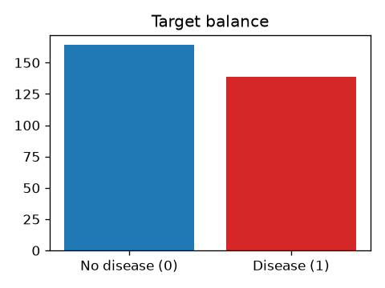

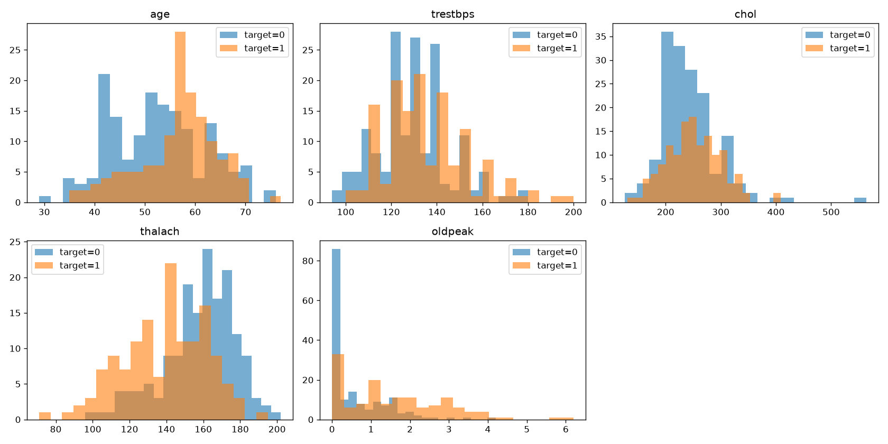

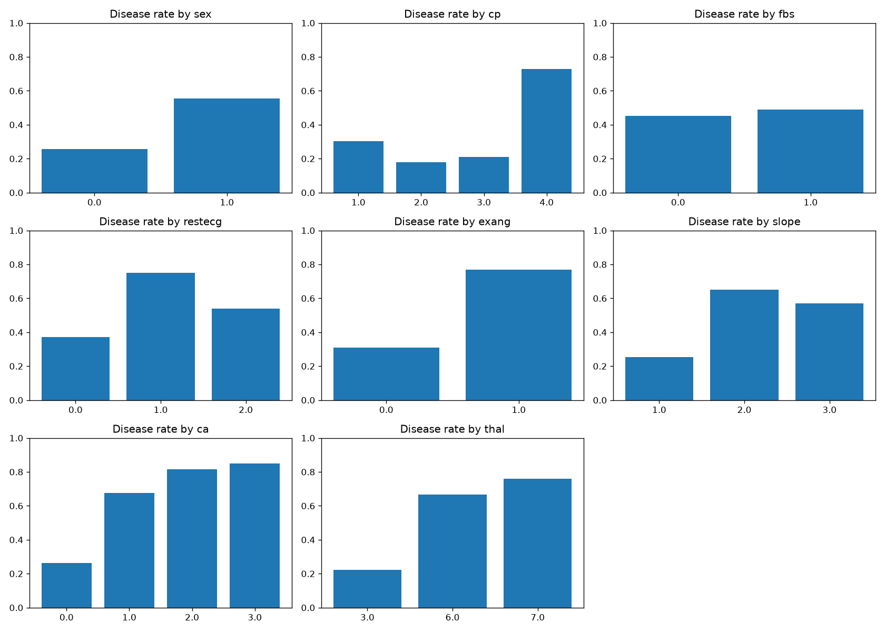

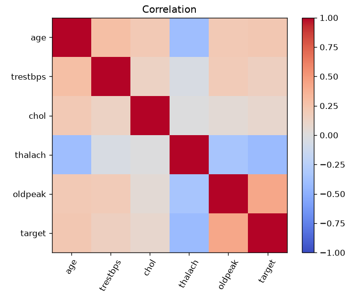

## 4. Methodology

- Split: stratified 80/20 hold-out (train n=242, test n=61), seed 42.
- Model selection: stratified 5-fold CV on the training split only; test set evaluated once.
- Candidates: majority-class dummy; logistic regression (balanced class weights); random forest (300 trees, min leaf 3); gradient boosting (150 trees, depth 2, lr 0.05).
- Out-of-fold (OOF) analysis: every record is predicted by a model that never saw it, giving a more stable estimate than the small test split.
- Interpretability: permutation importance (test set) and SHAP TreeExplainer (contributions of one-hot columns summed back to the original feature).

## 5. Model comparison

| model | roc_auc_mean | roc_auc_std | recall_mean | precision_mean | f1_mean | accuracy_mean | OOF AUC (all 303) |
|---|---|---|---|---|---|---|---|
| dummy_most_frequent | 0.5 | 0.0 | 0.0 | 0.0 | 0.0 | 0.541 | 0.5 |
| logistic_regression | 0.902 | 0.015 | 0.81 | 0.873 | 0.837 | 0.855 | 0.915 |
| random_forest | 0.897 | 0.03 | 0.774 | 0.788 | 0.776 | 0.797 | 0.916 |
| gradient_boosting | 0.869 | 0.027 | 0.774 | 0.776 | 0.77 | 0.789 | 0.895 |

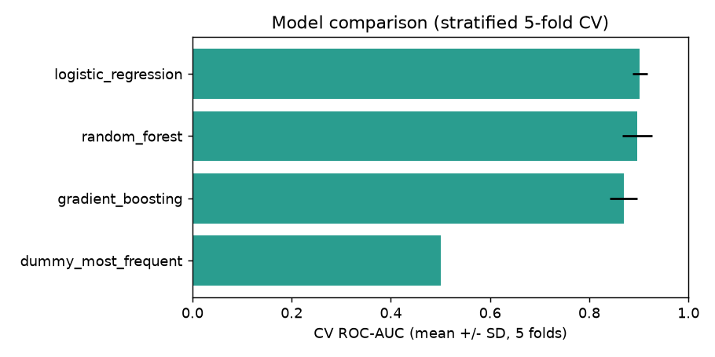

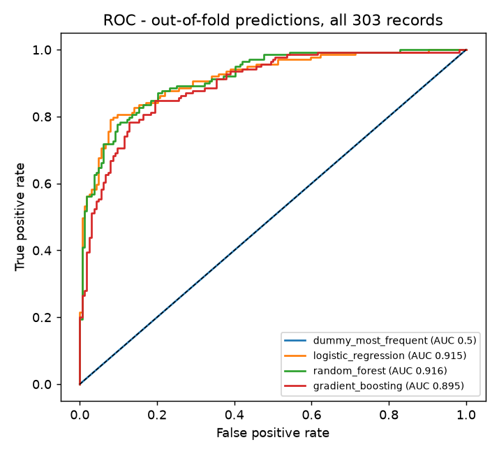

## 6. Final model performance

| Evaluation | ROC-AUC | Recall | Precision | F1 | Accuracy |
|---|---|---|---|---|---|
| Hold-out test (n=61) | 0.949 | 0.964 | 0.818 | 0.885 | 0.885 |
| OOF, all 303 records (t=0.5) | 0.916 | 0.799 | 0.835 | 0.816 | 0.835 |

Brier score (OOF): 0.12. Average precision (OOF): 0.91.

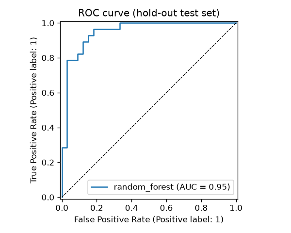

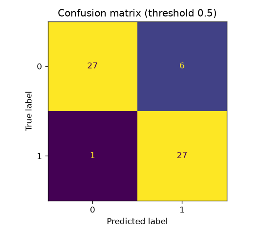

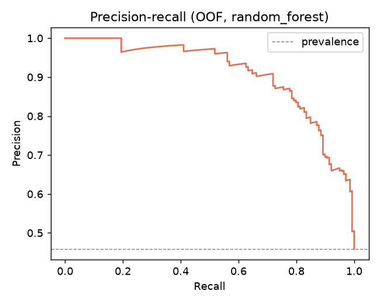

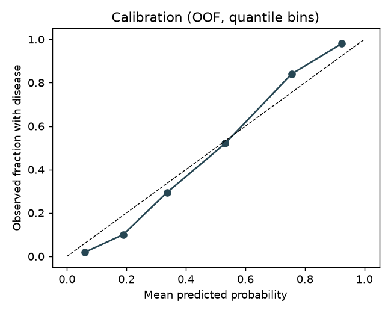

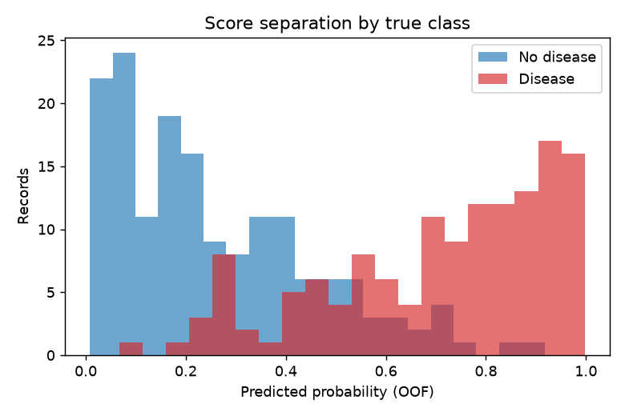

## 7. Threshold analysis and operating points

| threshold | tp | fp | fn | tn | precision | recall | specificity | f1 |
|---|---|---|---|---|---|---|---|---|
| 0.3 | 126.0 | 55.0 | 13.0 | 109.0 | 0.696 | 0.906 | 0.665 | 0.787 |
| 0.4 | 122.0 | 38.0 | 17.0 | 126.0 | 0.762 | 0.878 | 0.768 | 0.816 |
| 0.5 | 111.0 | 22.0 | 28.0 | 142.0 | 0.835 | 0.799 | 0.866 | 0.816 |
| 0.6 | 100.0 | 12.0 | 39.0 | 152.0 | 0.893 | 0.719 | 0.927 | 0.797 |
| 0.7 | 87.0 | 6.0 | 52.0 | 158.0 | 0.935 | 0.626 | 0.963 | 0.75 |

| operating point | threshold | tn | fp | fn | tp | precision | recall | specificity | f1 | accuracy |
|---|---|---|---|---|---|---|---|---|---|---|
| Default (0.5) | 0.5 | 142 | 22 | 28 | 111 | 0.835 | 0.799 | 0.866 | 0.816 | 0.835 |
| Youden's J (max sensitivity+specificity) | 0.527 | 147 | 17 | 30 | 109 | 0.865 | 0.784 | 0.896 | 0.823 | 0.845 |
| Highest threshold with recall >= 0.90 | 0.31 | 109 | 55 | 13 | 126 | 0.696 | 0.906 | 0.665 | 0.787 | 0.776 |

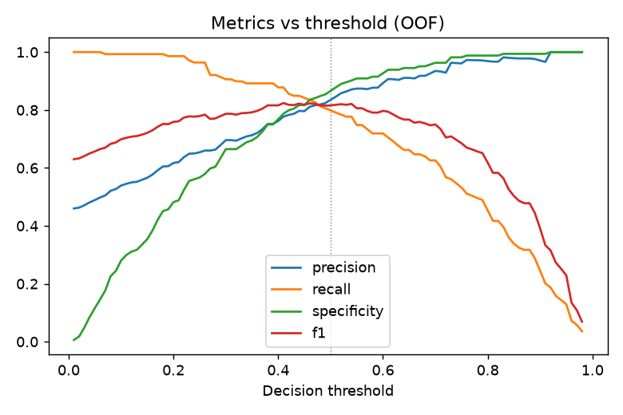

## 8. Subgroup performance (OOF, threshold 0.5)

| attribute | group | n | prevalence | roc_auc | recall | precision | accuracy |
|---|---|---|---|---|---|---|---|
| Sex | Female | 97 | 0.258 | 0.94 | 0.72 | 0.9 | 0.907 |
| Sex | Male | 206 | 0.553 | 0.893 | 0.816 | 0.823 | 0.801 |
| Age band | <50 | 87 | 0.299 | 0.941 | 0.731 | 0.905 | 0.897 |
| Age band | 50-59 | 125 | 0.48 | 0.913 | 0.8 | 0.8 | 0.808 |
| Age band | 60+ | 91 | 0.582 | 0.875 | 0.83 | 0.846 | 0.813 |
| Chest pain type | Asymptomatic | 144 | 0.729 | 0.913 | 0.905 | 0.888 | 0.847 |
| Chest pain type | Atypical angina | 50 | 0.18 | 0.84 | 0.333 | 0.75 | 0.86 |
| Chest pain type | Non-anginal pain | 86 | 0.209 | 0.863 | 0.611 | 0.647 | 0.849 |
| Chest pain type | Typical angina | 23 | 0.304 | 0.554 | 0.286 | 0.4 | 0.652 |

AUC is shown only for groups with n >= 20 and both classes present.

## 9. Error analysis and explainability

At threshold 0.5 the OOF predictions contain 28 false negatives and 22 false positives out of 303 records (TP=111, TN=142). The most confident errors:

| record_id | error_type | p_disease | age | sex | cp | thalach | oldpeak | ca | thal |
|---|---|---|---|---|---|---|---|---|---|
| 145 | False negative | 0.067 | 47.0 | 1.0 | 3.0 | 152.0 | 0.0 | 0.0 | 3.0 |
| 252 | False positive | 0.917 | 64.0 | 1.0 | 4.0 | 105.0 | 0.2 | 1.0 | 7.0 |
| 92 | False positive | 0.827 | 62.0 | 1.0 | 3.0 | 146.0 | 1.8 | 3.0 | 7.0 |
| 32 | False negative | 0.189 | 64.0 | 1.0 | 3.0 | 158.0 | 0.0 | 0.0 | 3.0 |
| 44 | False negative | 0.22 | 61.0 | 0.0 | 4.0 | 169.0 | 0.0 | 0.0 | 3.0 |

**Global feature ranking (mean |SHAP|, deployed model)**

| feature | mean_abs_shap |
|---|---|
| Thalassemia test result | 0.1322 |
| Major vessels coloured by fluoroscopy (0-3) | 0.0822 |
| Chest pain type | 0.0789 |
| Exercise-induced angina | 0.0486 |
| Slope of peak-exercise ST segment | 0.0443 |
| Sex | 0.043 |
| ST depression (exercise vs rest) | 0.0334 |
| Max heart rate achieved | 0.0316 |
| Age (years) | 0.0247 |
| Resting ECG result | 0.0141 |
| Serum cholesterol (mg/dl) | 0.0136 |
| Resting blood pressure (mm Hg) | 0.0096 |
| Fasting blood sugar > 120 mg/dl | 0.0016 |

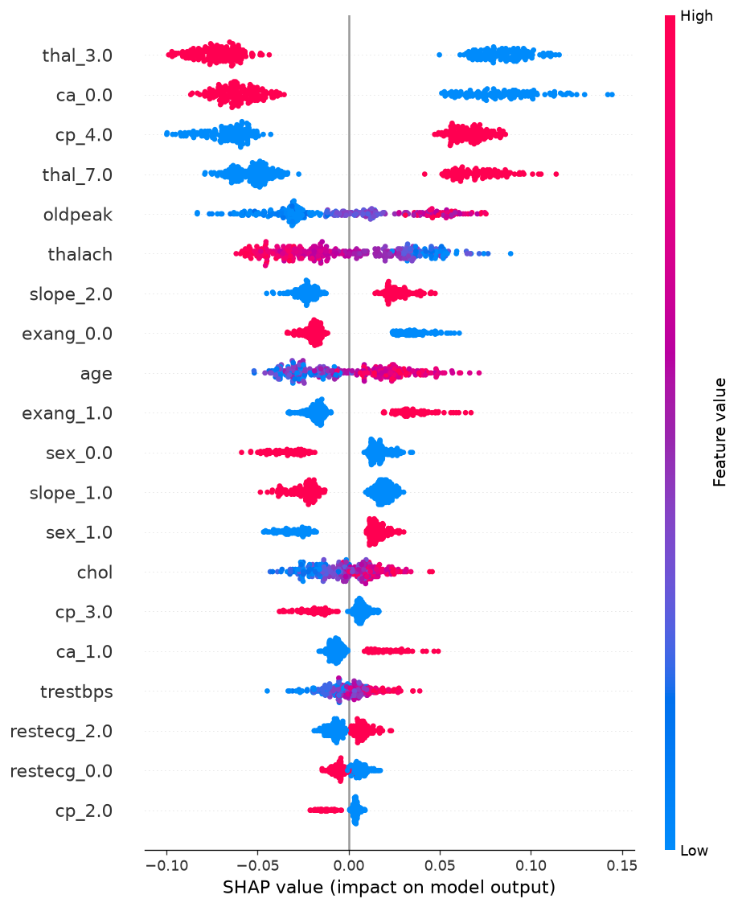

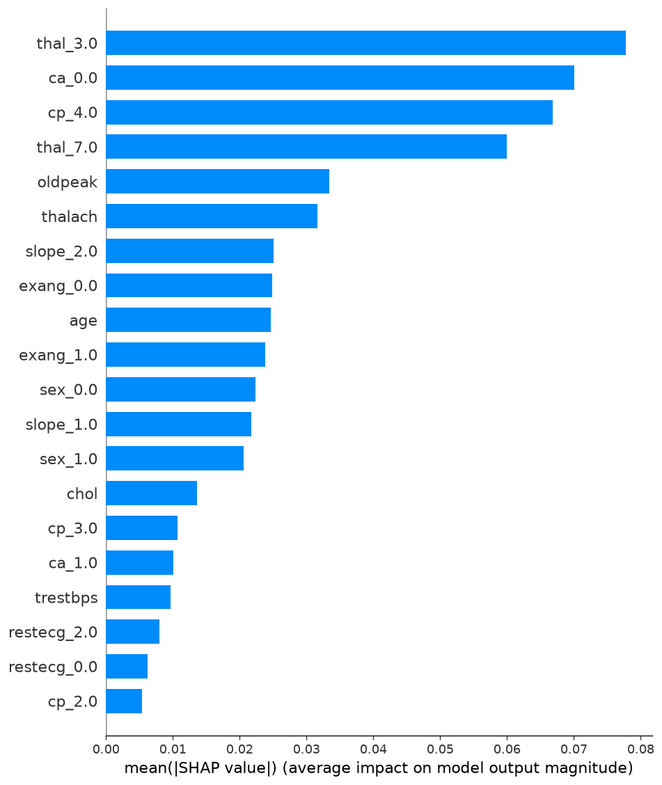

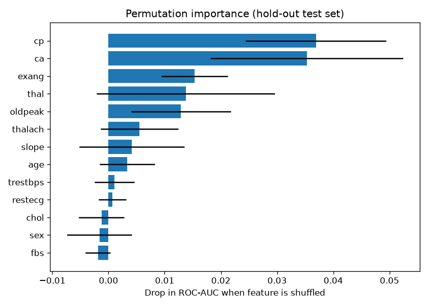

## 10. Notes on interpretation

- Sample is small (n=303); confidence intervals are wide and small model differences are within noise.
- Data come from one site and an earlier era; no external validation set was used.
- Records are 68% male and carry no ethnicity information, so subgroup claims beyond Section 8 cannot be made.
- SHAP describes the model's behaviour, not causal medical relationships.
- Outputs are model estimates for educational use and are not a medical diagnosis.

## 11. Reproducibility

- Seed 42; scikit-learn 1.7.2, shap 0.51.0, pandas 2.3.3, numpy 2.2.6.
- Commands: `python -m src.eda && python -m src.train && python -m src.explain && python -m src.analysis && python -m src.report`.